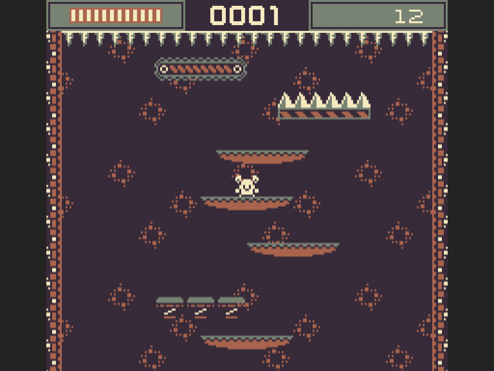

# falling

A remake of [NS-SHAFT](https://www.nagi-p.com/v1/eng/nsshaft.html) written in Zig and SDL3.

## playing

[Play online](https://coat.github.io/falling) or
[download](https://github.com/coat/falling/releases) a binary for your
operating system. `falling.zip` is for [PortMaster](http://portmaster.games/).

`nix run github:coat/falling` for more civilized folks.

Use arrow keys or `a` or `d` to move left or right. Try and avoid spiky
platforms and the spikes at the top. Land on other platforms to restore health.
Game is over when you fall to the bottom.

## building

### Requirements

1. Zig 0.17.1
2. emscripten (optional to build web version)
3. SDL3 provided by your system **or** SDL3's dependencies to build and
   statically include SDL3 in the binary.
4. Android SDK for optional Android build.

Instead of installing above dependencies, just install Nix and either run `nix
develop` or also install direnv and run `direnv allow` to make your dreams come
true.

`zig build -Dtarget=ReleaseSmall` and the game will be in
`zig-out/bin/falling`.

## procrastinating

- [ ] fix janky trampoline animation
- [ ] add animations for conveyor belts
- [ ] different difficulty levels
- [ ] local multi-player

## crediting

- Uses the [1-bit](https://kenney.nl/assets/tag:1-bit) collection of assets
from Kenney.

- Uses [dustbyte](https://web.archive.org/web/20260406184327/https://lospec.com/palette-list/dustbyte) 4-color palette.

- Uses [Lapse font](https://damieng.com/typography/zx-origins/lapse/) by Damien
Guard from ZX Origins collection.

## acknowledging

- a lot of code taken from [breakout
game](https://github.com/castholm/zig-examples/tree/master/breakout) from
zig-examples.

- A [reverse engineered version](https://github.com/cdfmr/NS-SHAFT-NS-TOWER) of
NS-SHAFT.

- [NAGI-P SOFT](https://www.nagi-p.com/v1/eng/) for making a great shareware
game.
